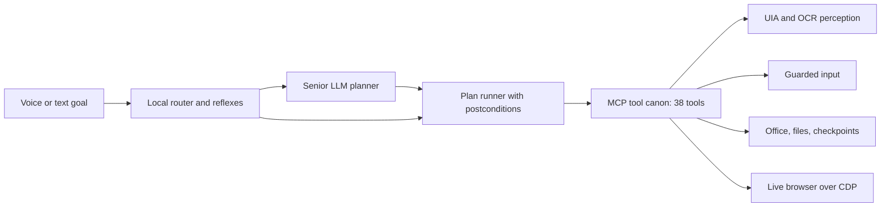

<div align="center">

# MCP-Hands: hands and eyes for computer-use agents on Windows

[](https://www.python.org/downloads/)
[](LICENSE)

[](#what-this-is)
[](https://vshymanskyy.github.io/StandWithUkraine/)

<a href="https://vshymanskyy.github.io/StandWithUkraine/">
  
</a>

---

[Русская версия](README.ru.md)

---

> A local Windows execution layer for computer-use agents: 38 MCP tools with guarded input,
> real screen perception and a live-browser protocol — plus a local voice assistant that
> solves routine goals without sending screenshots to a model.


*Live scenario, real run: the agent found the latest news digest of a specific channel by a
title pattern, opened it and started playback (YouTube in the owner's own Opera, CDP protocol).*

</div>

---

## What this is

MCP-Hands gives a language model **hands and eyes on a real Windows desktop** — and gives its
owner a **local voice assistant** that handles everyday goals itself.

Two consumers, one tool canon:

- **an MCP server** (`mcp` 2.3.0, stdio) exposes 38 tools: perception (UI Automation, Windows
  OCR), guarded input, files, Office (Word/Excel/PDF), and a live browser over CDP;
- **a local assistant** ("Jarvis") that listens, resolves simple goals with local rules and
  saved recipes, and calls a senior LLM only for new formulations.

The project's working rule: **think rarely, act often, verify by fact.** Cheap and obvious
steps are decided locally; every action is confirmed against the world (DOM state, OCR text,
window Z-order, file hashes) rather than by the model's own word.

*Status: frozen at `v0.9-frozen` (19 Oct 2026) — tagged, tested, development paused.
State and resume instructions: [docs/FROZEN.md](docs/FROZEN.md).*

---

## Key metrics

*Measured on the live bench — a real Windows desktop with real Office, a real browser and
real user sessions:*

| What | Result | Where it comes from |
|---|---|---|
| Staged benchmark, 10 tasks | **30/30** over a 3×10 series; one full round ≈ **22 s** | `logs/benchmark/summary_metrics.md` |
| Agent vs human, 9 matched tasks | **48.0 s vs 1028 s → ×21.4** (per task ×8.5 … ×212.1) | `docs/HUMAN_BASELINE.md` |
| Live missions on the owner's machine | **10 run, 7 achieved**, 3 open with named reasons | `docs/MISSIONS_RUN.md` |
| Repeated goal solved by recipe | **1.3–6.8 s, 0 model tokens** | `docs/COMPARE_HANDS_VS_IAB.md` |
| Test suite | **248 tests**: **248 passed** on a live desktop; a limited (headless) session skips the live ones — e.g. **221 passed + 27 skipped** | `pytest -q` |
| UIA element search | median **9.8 ms**; cached properties **0.055 ms/element** vs 1.7–2.6 ms live | `spike/RESULTS.md` |
| Screen capture | DXGI frame copy **1.42 ms** (p95 1.79) vs BitBlt **33.0 ms**; window crop 0.54 ms | `spike/RESULTS.md` |
| Window-event delivery | **≤0.5 ms** to the hook thread | `spike/RESULTS.md` |
| Screen OCR | **15 ms** per 1125×700 crop, 0 VRAM (built-in Windows engine) | `spike/RESULTS.md` |
| Voice recognition | local Whisper on CPU, **≈2–4 s** per phrase | `mcp_hands/assistant/voice.py` |

---

## Architecture



Three layers, each with a job it can be trusted with:

- **Perception.** UI Automation first (structured, cheap), Windows OCR as the pixel fallback.
  Every reading carries facts: window handles, Z-order occlusion, text lines with rectangles.
- **Action.** Input goes through one guarded actuator: the target window must be foreground,
  its integrity level must allow input, and keyboard events require an explicit expected
  window. There are no tools for "send", "pay" or "publish" — the stop-list works by absence.
- **Verification.** Each step declares what must become true; the runner checks it against the
  world, retries, replans within limits, and rolls back file mutations from checkpoints.
  An independent L2 inspector re-reads Office artefacts without COM (zip + XML + SHA-256).

---

## Engineering highlights

**Windows OCR instead of a vision model for reading.** The built-in engine reads a window crop
in 15 ms with zero VRAM, which made "read the screen" cheap enough to use per step. The
consequence is honest: OCR misreads small fonts, so its output is never treated as truth — it
is a hint that gets confirmed by UI Automation or a state check.

**Occlusion as a first-class fact.** Screen capture reads a *rectangle*, not a window. When
another window covers the target, a naive reader happily returns someone else's text (we hit
exactly that: OCR of "the Opera window" returned our own log). The perception layer now reports
occlusion share and who is covering, and the agent says "the window is hidden" instead of
inventing content.

**Input with guards, not blind clicks.** Every click is preceded by a desktop check, an
integrity-level check and window activation; every keyboard event requires the expected window
handle. Coordinates invented by a model are not acceptable input anywhere in the canon.

**Live browser by protocol, pixels as fallback.** Opera GX is driven over CDP: tabs, DOM
search, clicks, video state, fullscreen. Pixel clicks exist for windows without an API
(external tiles, third-party apps) and are always "find text, then click the found element,
then verify the frame changed" — never coordinates from a guess.

**Recipes instead of re-planning.** A goal that succeeded is stored as a recipe; the same goal
next time runs deterministically, in seconds, without a single model token. New formulations
still go through the planner — that is the expensive path, and the code says so.

**Honest measurement instead of "it worked".** The mission protocol verifies the *world*
(e.g. "the page URL is youtube.com", "the channel is Michael Naki", "no new outgoing message
appeared"), and a failed claim is written down as a failure with its reason — see
`docs/MISSIONS_RUN.md`.

---

## Safety and policy

Four levels, enforced in the executor's code (a model cannot argue with them):

0. **Kernel rules** — system drive and system folders are read-only; deletions go to the
   recycle bin; system files and drivers are never touched.
1. **User stop-list** — localized button heuristics ("Send", "Pay", "Publish", "Delete"),
   blocked applications and folders.
2. **Grey zone → pause and ask the human** — the run stops and reports why.
3. **Allowed** — everything else, with a journal.

Also built in: a full JSONL operation journal (input texts are counted, not stored), dry-run
mode that shows the plan without executing, artefact checkpoints with SHA-256 manifests and
rollback, and the rule that the owner's browser tabs are never closed or reordered — the agent
opens its own tab and works there.

---

## Project structure

```
mcp_hands/
├── mcp_server.py        # MCP server: 38 tools, ToolResult contract, JSONL journal
├── uia.py               # UI Automation perception (tree, cached properties, search)
├── screen.py            # screen capture: DXGI primary, BitBlt/mss fallback, frame signature
├── ocr.py               # built-in Windows OCR wrapper (words, lines, rectangles)
├── input.py             # the only actuator: guarded input, verified clicks, wheel
├── geometry.py          # coordinate spaces, DPI awareness, window frames, occlusion
├── events.py            # WinEvent hooks on a message-loop thread
├── office.py            # Word/Excel COM sessions with liveness guards
├── live.py              # live Opera over CDP: tabs, DOM, video, fullscreen, picking
├── files.py             # file policy: trash-only deletion, sorting by type
├── checkpoints.py       # artefact checkpoints: SHA-256 manifest and rollback
├── memory.py            # SQLite runs/steps/llm_calls/incidents + autonomy metrics
├── brain/               # planner (strict schema), plan runner, LLM client, recipes
├── assistant/           # Jarvis: voice in/out, router, dialogue memory, goal loop, overlay
├── benchmark/           # stands for the staged 10-task benchmark and the metrics report
└── scenarios/           # stage-1 scenarios: Notepad via UIA, Word→PDF via COM, CDP links
tools/                   # hands_cli (interactive MCP console), jarvis.py, mission runner,
                         #   Jarvis GUI panel, voice picker, Opera debug launcher
tests/                   # 248 tests, including live ones on real windows
docs/                    # DESIGN, ROADMAP, mission runs, human baseline, prior art, freezing
spike/                   # stage-0 measurements (UIA, DXGI, DPI, events, OCR, VLM probe)
```

---

## Quick start

```powershell
git clone https://github.com/Bileneret/mcp-hands.git
cd mcp-hands
py -3 -m venv .venv
.venv\Scripts\python.exe -m pip install -r requirements.txt   # pinned runtime set
# full frozen environment (89 packages, exact versions):
# .venv\Scripts\python.exe -m pip install -r requirements.lock.txt

.venv\Scripts\python.exe -m pytest -q          # 248 passed on a live desktop
.venv\Scripts\python.exe tools\hands_cli.py    # interactive MCP console: health, tools, call, demo
```

The LLM is configured in `config.local.json` (never committed) — copy `config.example.json`
and fill in your provider:

```json
{
  "llm": {"base_url": "https://your-provider.example/v1", "api_key": "…your key…",
          "model": "your-model"}
}
```

Voice assistant (optional): `.venv\Scripts\python.exe tools\jarvis_panel.py` — pick a
microphone, listen to the available voices, run a recognition test, then start Jarvis
(`Ctrl+Alt+J` wakes it up; silence puts it back to sleep).

---

## Connect as an MCP server

```json
{
  "mcpServers": {
    "mcp-hands": {
      "command": "D:\\BOT\\MCP-Hands\\.venv\\Scripts\\python.exe",
      "args": ["-m", "mcp_hands.mcp_server"]
    }
  }
}
```

Works with any MCP client (ZCode, Claude Desktop, and others); details and safety notes —
[docs/CONNECT.md](docs/CONNECT.md).

---

## Voice assistant

The local assistant resolves goals end to end: it records with VAD, transcribes with Whisper
locally, routes the phrase (instant local intents → saved recipes → planner for new goals),
acts through the same 38 tools, and answers in a chosen Russian voice (three local/online
providers). Dialogue memory and recipes live in SQLite. It runs in a "conversation" mode:
one hotkey wakes it, phrases are handled one after another, and a long pause puts it back to
sleep.

---

## Honest limitations

- **New goals are not free.** Anything outside local intents and saved recipes goes through
  the planner: tens of seconds and thousands of tokens. Cheap repeats are exactly what the
  recipe store is for.
- **Three live missions are still open** (Twitch, a university portal needing the owner's
  session, and building a Word note from open tabs) — listed with reasons in
  `docs/MISSIONS_RUN.md`. No retries were dressed up as successes.
- **No CI.** There is no workflow in this repository, so there is no CI badge; the test suite
  is meant to run on a live Windows desktop, where the live subset can actually work. In a
  headless session those tests are skipped rather than failed — the honest shape is
  "221 passed + 27 skipped" out of 248, and the README's metrics row says exactly that.
- **Windows-only by design.** The whole point is Win32/UIA/COM/CDP behaviour on a real machine.
- **OCR is a hint, not truth** (see highlights), and 60-Hz screenshots are not a timing source
  for anything that needs millisecond precision.

---

## Acknowledgments & disclaimer

Built on: [mcp](https://github.com/modelcontextprotocol/python-sdk) (MIT),
[comtypes](https://github.com/enthought/comtypes) (MIT),
[pywin32](https://github.com/mhammond/pywin32) (PSF),
[numpy](https://numpy.org/) (BSD-3), [Pillow](https://python-pillow.org/) (MIT-CMU),
[dxcam](https://github.com/ra1nty/DXcam) (MIT), [mss](https://github.com/BoboTiG/python-mss)
(MIT), [winsdk](https://github.com/pywinrt/pywinrt) (MIT),
[websocket-client](https://github.com/websocket-client/websocket-client) (Apache-2.0),
[pydantic](https://github.com/pydantic/pydantic) (MIT),
[faster-whisper](https://github.com/SYSTRAN/faster-whisper) (MIT) with
[ctranslate2](https://github.com/OpenNMT/CTranslate2) (MIT),
[piper](https://github.com/rhasspy/piper) (MIT), [edge-tts](https://github.com/rany2/edge-tts)
(GPL-3.0), [sounddevice](https://github.com/spatialaudio/python-sounddevice) (MIT).

The README style follows the author's other repositories
([connect4_agent](https://github.com/Bileneret/connect4_agent),
[QueensBot](https://github.com/Bileneret/QueensBot)); every stage of this project (v1 … v31)
went through an independent external audit whose findings are fixed in the commit history.

**Purpose and limits.** This is a research and engineering tool: it exists to measure what a
local execution layer can honestly do on a real desktop. Automating third-party services may
violate their terms of use — use it only where you are authorized. The tool set deliberately
contains no sending, payment or publishing actions, and the live-browser layer never touches
the owner's own tabs.

---

## License

[AGPL-3.0](LICENSE). Commercial licensing is available on request — if AGPL does not fit your
use case, contact the author.
