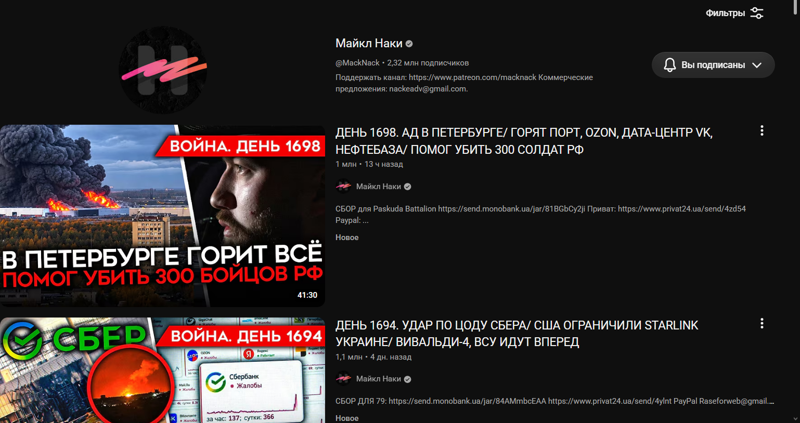
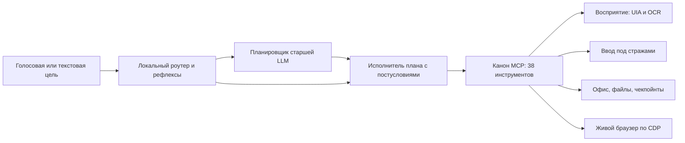

<div align="center">

# MCP-Hands: руки и глаза для computer-use агентов на Windows

[](https://www.python.org/downloads/)
[](LICENSE)

[](#что-это)

[English version](README.md)

> Локальный исполнительный слой для computer-use агентов на Windows: 38 MCP-инструментов с
> вводом под стражами, настоящим зрением и живым браузером по протоколу — плюс локальный
> голосовой ассистент, который решает рутинные цели без отправки скриншотов в модель.



*Живой прогон: агент нашёл свежую новостную сводку нужного канала по признаку в заголовке,
открыл её и включил воспроизведение (YouTube в Опере владельца, протокол CDP).*

</div>

---

## Что это

MCP-Hands даёт языковой модели **руки и глаза на настоящем рабочем столе Windows**, а своему
владельцу — **локального голосового ассистента**, который сам закрывает повседневные цели.

Два потребителя, один канон инструментов:

- **MCP-сервер** (`mcp` 2.3.0, stdio) отдаёт 38 инструментов: восприятие (UI Automation,
  встроенный OCR Windows), ввод под стражами, файлы, Office (Word/Excel/PDF) и живой браузер
  по CDP;
- **локальный ассистент** («Джарвис») слушает, решает простые цели локальными правилами и
  сохранёнными рецептами, а старшую LLM зовёт только для новых формулировок.

Рабочее правило проекта: **думать редко, делать часто, проверять фактом.** Дешёвые и
очевидные шаги решаются на месте; каждое действие подтверждается состоянием мира (DOM
страницы, распознанный текст, Z-порядок окон, хеши файлов), а не словом модели.

*Статус: заморожен на `v0.9-frozen` (19.10.2026) — тег, тесты пройдены, разработка на паузе.
Состояние и инструкция по возобновлению: [docs/FROZEN.md](docs/FROZEN.md).*

---

## Ключевые метрики

*Замерено на живом стенде — реальный рабочий стол Windows, настоящий Office, настоящий
браузер и настоящие пользовательские сессии:*

| Что | Результат | Откуда цифра |
|---|---|---|
| Стендовый бенчмарк, 10 задач | **30/30** в серии 3×10; полный круг ≈ **22 с** | `logs/benchmark/summary_metrics.md` |
| Агент против человека, 9 сопоставленных задач | **48.0 с против 1028 с → ×21.4** (по задачам ×8.5 … ×212.1) | `docs/HUMAN_BASELINE.md` |
| Живые миссии на машине владельца | **10 прогнано, 7 достигнуто**, 3 открыты с названными причинами | `docs/MISSIONS_RUN.md` |
| Повторная цель по рецепту | **1.3–6.8 с, 0 токенов модели** | `docs/COMPARE_HANDS_VS_IAB.md` |
| Тестовый набор | **248 тестов**: **248 passed** на живом рабочем столе; в ограниченной (безголовой) сессии живые тесты пропускаются — например, **221 passed + 27 skipped** | `pytest -q` |
| Поиск элемента в UIA | медиана **9.8 мс**; свойства из кэша **0.055 мс/элемент** против 1.7–2.6 мс «живьём» | `spike/RESULTS.md` |
| Захват экрана | копия кадра DXGI **1.42 мс** (p95 1.79) против BitBlt **33.0 мс**; кроп окна 0.54 мс | `spike/RESULTS.md` |
| Доставка оконных событий | **≤0.5 мс** в поток хука | `spike/RESULTS.md` |
| OCR экрана | **15 мс** на кроп 1125×700, 0 видеопамяти (встроенный движок Windows) | `spike/RESULTS.md` |
| Распознавание речи | локальный Whisper на CPU, **≈2–4 с** на фразу | `mcp_hands/assistant/voice.py` |

---

## Архитектура



Три слоя, каждому — работа, которой можно доверять:

- **Восприятие.** Сначала UI Automation (структурно и дёшево), встроенный OCR Windows — как
  пиксельный запасной путь. Каждое чтение несёт факты: дескрипторы окон, перекрытие по
  Z-порядку, строки текста с прямоугольниками.
- **Действие.** Ввод идёт через один актуатор под стражами: целевое окно обязано быть
  активным, уровень целостности — допускать ввод, а клавиатурные события требуют явно
  указанного ожидаемого окна. Инструментов «отправить», «оплатить» и «опубликовать» нет —
  стоп-лист работает отсутствием.
- **Проверка.** Каждый шаг объявляет, что должно стать истинным; исполнитель проверяет это
  против мира, повторяет, перепланирует в пределах лимитов и откатывает файловые изменения из
  чекпойнтов. Независимый L2-инспектор перечитывает артефакты Office без COM (zip + XML + SHA-256).

---

## Инженерные находки

**Встроенный OCR Windows вместо модели зрения для чтения.** Системный движок читает кроп окна
за 15 мс при нуле видеопамяти — «прочитать экран» стало достаточно дешёвым, чтобы делать это на
каждом шаге. Следствие честное: мелкий шрифт OCR иногда читает неверно, поэтому его результат
никогда не считается истиной — это подсказка, которую подтверждают UI Automation или проверка
состояния.

**Перекрытие окна — факт первого класса.** Захват экрана читает *прямоугольник*, а не окно.
Когда цель закрыта другим окном, наивный читатель спокойно возвращает чужой текст (мы ровно на
это и наступили: OCR «окна Opera» вернул наш собственный лог). Теперь слой восприятия отдаёт
долю перекрытия и виновника, и агент говорит «окно не видно» вместо выдумывания содержимого.

**Ввод со стражами, а не слепые клики.** Каждому клику предшествуют проверка рабочего стола,
проверка уровня целостности и активация окна; каждое клавиатурное событие требует ожидаемого
дескриптора окна. Координаты, придуманные моделью, нигде в каноне не считаются допустимым вводом.

**Живой браузер по протоколу, пиксели — как фолбэк.** Opera GX управляется через CDP: вкладки,
поиск по DOM, клики, состояние видео, полный экран. Пиксельные клики существуют для окон без API
(внешние плитки, сторонние приложения) и всегда работают по схеме «найти текст → кликнуть по
найденному элементу → проверить, что кадр изменился» — никогда по координатам-догадке.

**Рецепты вместо повторного планирования.** Удавшаяся цель сохраняется как рецепт; в следующий
раз та же цель исполняется детерминированно, за секунды и без единого токена модели. Новые
формулировки по-прежнему идут через планировщик — это дорогой путь, и код об этом честно говорит.

**Честное измерение вместо «сработало».** Протокол миссий проверяет *мир* (например: «адрес
страницы — youtube.com», «канал — Майкл Наки», «нового исходящего сообщения не появилось»), и
провалившееся утверждение записывается как провал с причиной — см. `docs/MISSIONS_RUN.md`.

---

## Безопасность и политика

Четыре уровня, проверяемые в коде исполнителя (модель не может с ними спорить):

0. **Правила ядра** — системный диск и системные каталоги только на чтение; удаление — только в
   корзину; системные файлы и драйверы не трогаются никогда.
1. **Стоп-лист пользователя** — эвристики по локализованным именам кнопок («Отправить»,
   «Оплатить», «Опубликовать», «Удалить»), запрещённые приложения и папки.
2. **Серая зона → пауза и вопрос человеку** — прогон останавливается и объясняет причину.
3. **Разрешено** — всё остальное, с журналом.

Встроено также: полный JSONL-журнал операций (тексты ввода считаются, но не сохраняются),
сухой прогон, показывающий план без исполнения, чекпойнты артефактов с SHA-256-манифестом и
откатом, и правило, что вкладки браузера владельца никогда не закрываются и не переставляются —
агент открывает свою вкладку и работает в ней.

---

## Структура проекта

```
mcp_hands/
├── mcp_server.py        # MCP-сервер: 38 инструментов, контракт ToolResult, JSONL-журнал
├── uia.py               # восприятие через UI Automation (дерево, кэш свойств, поиск)
├── screen.py            # захват экрана: DXGI основной, BitBlt/mss резервный, подпись кадра
├── ocr.py               # обёртка встроенного OCR Windows (слова, строки, прямоугольники)
├── input.py             # единственный актуатор: ввод под стражами, проверенные клики, колесо
├── geometry.py          # пространства координат, DPI, рамки окон, перекрытие
├── events.py            # хуки WinEvent в потоке с циклом сообщений
├── office.py            # сессии COM Word/Excel со стражами живости
├── live.py              # живая Opera по CDP: вкладки, DOM, видео, полный экран, выбор ролика
├── files.py             # политика файлов: удаление только в корзину, разбор по типам
├── checkpoints.py       # чекпойнты артефактов: SHA-256-манифест и откат
├── memory.py            # SQLite runs/steps/llm_calls/incidents + метрики автономности
├── brain/               # планировщик (строгая схема), исполнитель плана, клиент LLM, рецепты
├── assistant/           # Джарвис: голос, роутер, память диалога, цикл цели, плашка
├── benchmark/           # стенды 10 задач и генератор сводки метрик
└── scenarios/           # сценарии этапа 1: Блокнот (UIA), Word→PDF (COM), ссылки (CDP)
tools/                   # hands_cli (интерактивная консоль MCP), jarvis.py, прогон миссий,
                         #   GUI-панель Джарвиса, выбор голоса, лончер Opera с отладкой
tests/                   # 248 тестов, включая живые — на настоящих окнах
docs/                    # DESIGN, ROADMAP, прогоны миссий, замер человека, разведка, заморозка
spike/                   # замеры этапа 0 (UIA, DXGI, DPI, события, OCR, проба VLM)
```

---

## Быстрый старт

```powershell
git clone https://github.com/Bileneret/mcp-hands.git
cd mcp-hands
py -3 -m venv .venv
.venv\Scripts\python.exe -m pip install -r requirements.txt   # рабочий набор зависимостей
# полное замороженное окружение (89 пакетов, точные версии):
# .venv\Scripts\python.exe -m pip install -r requirements.lock.txt

.venv\Scripts\python.exe -m pytest -q          # 248 passed на живом рабочем столе
.venv\Scripts\python.exe tools\hands_cli.py    # интерактивная консоль MCP: health, tools, call, demo
```

LLM настраивается в `config.local.json` (в репозиторий не попадает) — скопируйте
`config.example.json` и заполните своим провайдером:

```json
{
  "llm": {"base_url": "https://ваш-провайдер.example/v1", "api_key": "…ваш ключ…",
          "model": "ваша-модель"}
}
```

Голосовой ассистент (опционально): `.venv\Scripts\python.exe tools\jarvis_panel.py` — выберите
микрофон, прослушайте доступные голоса, проверьте распознавание и запустите Джарвиса
(`Ctrl+Alt+J` будит его, тишина — усыпляет).

---

## Подключение как MCP-сервер

```json
{
  "mcpServers": {
    "mcp-hands": {
      "command": "D:\\BOT\\MCP-Hands\\.venv\\Scripts\\python.exe",
      "args": ["-m", "mcp_hands.mcp_server"]
    }
  }
}
```

Работает с любым MCP-клиентом (ZCode, Claude Desktop и другими); подробности и замечания по
безопасности — [docs/CONNECT.md](docs/CONNECT.md).

---

## Голосовой ассистент

Локальный ассистент проходит цель целиком: пишет с микрофона с VAD, распознаёт Whisper локально,
маршрутизирует фразу (мгновенные интенты → сохранённые рецепты → планировщик для новых целей),
действует теми же 38 инструментами и отвечает выбранным русским голосом (три провайдера —
локальный и онлайн). Память диалога и рецепты живут в SQLite. Есть режим разговора: одна горячая
клавиша включает микрофон, фразы обрабатываются подряд, а долгая пауза возвращает ассистента в сон.

---

## Честные ограничения

- **Новые цели не бесплатны.** Всё, что вне локальных интентов и сохранённых рецептов, уходит
  планировщику: десятки секунд и тысячи токенов. Дешёвые повторы — ровно то, для чего нужен
  склад рецептов.
- **Три живые миссии ещё открыты** (Twitch, учебный портал с входом владельца, заметка в Word из
  открытых вкладок) — с причинами в `docs/MISSIONS_RUN.md`. Ни один повтор не выдан за успех.
- **Нет CI.** В репозитории нет workflow, поэтому нет и бейджа CI; набор тестов рассчитан на
  живой рабочий стол Windows, где живая часть может работать по-настоящему. В безголовой сессии
  эти тесты не падают, а пропускаются — честная картина «221 passed + 27 skipped» из 248, и
  строка метрик в README говорит именно это.
- **Только Windows — по замыслу.** Смысл проекта именно в поведении Win32/UIA/COM/CDP на
  настоящей машине.
- **OCR — подсказка, не истина** (см. находки), а кадры 60 Гц не являются источником времени для
  всего, что требует миллисекундной точности.

---

## Благодарности и дисклеймер

Построено на: [mcp](https://github.com/modelcontextprotocol/python-sdk) (MIT),
[comtypes](https://github.com/enthought/comtypes) (MIT),
[pywin32](https://github.com/mhammond/pywin32) (PSF),
[numpy](https://numpy.org/) (BSD-3), [Pillow](https://python-pillow.org/) (MIT-CMU),
[dxcam](https://github.com/ra1nty/DXcam) (MIT), [mss](https://github.com/BoboTiG/python-mss)
(MIT), [winsdk](https://github.com/pywinrt/pywinrt) (MIT),
[websocket-client](https://github.com/websocket-client/websocket-client) (Apache-2.0),
[pydantic](https://github.com/pydantic/pydantic) (MIT),
[faster-whisper](https://github.com/SYSTRAN/faster-whisper) (MIT) с
[ctranslate2](https://github.com/OpenNMT/CTranslate2) (MIT),
[piper](https://github.com/rhasspy/piper) (MIT), [edge-tts](https://github.com/rany2/edge-tts)
(GPL-3.0), [sounddevice](https://github.com/spatialaudio/python-sounddevice) (MIT).

Стиль README следует другим репозиториям автора
([connect4_agent](https://github.com/Bileneret/connect4_agent),
[QueensBot](https://github.com/Bileneret/QueensBot)); каждый этап этого проекта (v1 … v31)
прошёл независимый внешний аудит, находки зафиксированы в истории коммитов.

**Назначение и границы.** Это research- и инженерный инструмент: он существует, чтобы измерить,
что локальный исполнительный слой может честно делать на настоящем рабочем столе. Автоматизация
сторонних сервисов может нарушать их условия использования — применяйте только там, где вы
уполномочены. В наборе инструментов сознательно нет отправки, оплаты и публикации, а живой
браузерный слой никогда не трогает собственные вкладки владельца.

---

## Лицензия

[AGPL-3.0](LICENSE). Коммерческое лицензирование возможно по отдельному договору — если AGPL не
подходит под ваш сценарий, свяжитесь с автором.
